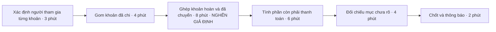
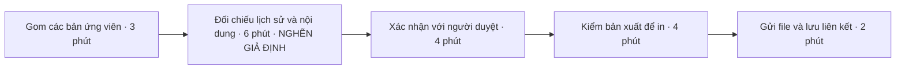
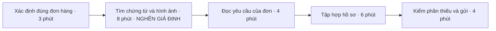

# Báo cáo cá nhân — bản nháp CP1–CP2

> Trạng thái: bản nháp do AI hỗ trợ soạn theo yêu cầu của học viên. Chưa có họ tên, MSSV, trải nghiệm hay số liệu thực tế được học viên cung cấp. Các chủ đề dưới đây là đề xuất để lựa chọn; thời gian trong ba sơ đồ là **mô phỏng**, không phải bằng chứng. Bản này cần được học viên kiểm tra và bổ sung trước khi nộp.

## 1. Thông tin học viên

- Họ tên: chưa điền.
- MSSV: chưa điền.
- Lớp: chưa điền.
- Tên nhóm: chưa điền.
- Link repo nhóm: chưa điền.
- Tên file khi nộp: đổi bản này thành `MSSV_HoTen.md`, dùng thông tin của chính học viên, và sửa tiêu đề cho khớp. Giữ template gốc cho các thành viên khác copy.

**Hướng ưu tiên đề xuất:** đối soát tiền chi hộ khi một đợt mua chung có hủy hoặc hoàn tiền một phần.

Hướng này khác bối cảnh báo cáo tuần của Product Manager trong bài mẫu: actor là người ứng tiền cho nhóm nhỏ; sự kiện kích hoạt là thay đổi một phần đơn hàng; đầu ra cần là số tiền còn phải thanh toán có thể truy vết. Hai hướng dự phòng là xác định đúng file đã chốt để in và tập hợp hồ sơ đổi trả. Chưa có cơ sở để khẳng định các hướng này không trùng với bài của học viên khác.

## 2. Scan problem (CP1)

### 2.1. Danh sách 10 gợi ý để học viên đối chiếu với trải nghiệm

**Nguồn ý tưởng:** AI đề xuất trong cuộc trao đổi này. Chưa có lượt tự scan trước đó được cung cấp. Chỉ giữ những dòng bản thân thực sự gặp hoặc có nguồn quan sát thật; không chuyển tình huống giả định thành trải nghiệm cá nhân. Danh sách hiện chưa đáp ứng điều kiện bằng chứng để nhận điểm CP1 hoặc bonus B1.

| ID | Lăng kính | Job Story: Khi… tôi muốn… để… | Actor đề xuất | Dấu hiệu thật cần bổ sung |
|---|---|---|---|---|
| P01 | Cần đọc, tổng hợp nhiều thông tin | Khi một đợt mua chung bị hủy hoặc hoàn một phần, tôi muốn xác định từng người còn phải thanh toán bao nhiêu sau các lần chi hộ và chuyển lại, để chốt tiền đúng mà không phải đối chiếu nhiều lần. | Người ứng tiền và chốt thu chi cho nhóm nhỏ. | Chưa có. Cần thời gian đối soát một đợt, số khoản chi/hoàn, số lần phải hỏi lại; nguồn là danh sách mua chung và chứng từ đã ẩn danh. |
| P02 | Lặp lại | Khi sắp gửi tài liệu nhóm đi in mà có nhiều bản sửa, tôi muốn xác định đúng bản đã được duyệt, để tránh in nhầm và làm lại. | Thành viên chịu trách nhiệm gửi in tài liệu hoặc poster. | Chưa có. Cần số bản phải đối chiếu, thời gian chọn bản, số lần gửi sai nếu có; nguồn là lịch sử file và xác nhận người duyệt. |
| P03 | Tốn thời gian | Khi một món đồ mua online cần đổi trả, tôi muốn tập hợp đúng đơn hàng, chứng từ và hình ảnh được yêu cầu, để gửi đủ hồ sơ ngay lần đầu. | Người mua tự xử lý yêu cầu đổi trả. | Chưa có. Cần thời gian gom hồ sơ, số nơi phải tìm, số lượt bổ sung; nguồn là đơn hàng và lịch sử yêu cầu đã ẩn danh. |
| P04 | Pain từ người khác | Khi đến hạn trả thiết bị mượn của câu lạc bộ nhưng đồ đã được chuyển qua nhiều người, tôi muốn xác định ai đang giữ từng món, để bàn giao đủ và không làm chậm buổi tiếp theo. | Người phụ trách nhận lại thiết bị dùng chung. | Chưa có. Cần số món chưa rõ người giữ, số lượt hỏi và thời gian tìm; chỉ giữ dòng này nếu có trải nghiệm hoặc người cung cấp thông tin thật. |
| P05 | Lặp lại | Khi phát áo cho nhóm có người nhận hộ và đổi kích cỡ, tôi muốn biết ai đã nhận món nào, để tránh phát thiếu hoặc phát trùng. | Thành viên phụ trách phát áo cho lớp hoặc câu lạc bộ. | Chưa có. Cần số lượt phát, số trường hợp nhận hộ/đổi, số lần phải kiểm lại; nguồn là danh sách nhận hàng. |
| P06 | Tốn thời gian | Khi cần đặt một phòng học nhóm, tôi muốn đối chiếu được thời gian các thành viên tham gia với các khung phòng còn dùng được, để chốt một buổi khả thi mà không hỏi đi hỏi lại. | Thành viên điều phối một buổi học nhóm. | Chưa có. Cần số vòng trao đổi, thời gian thao tác và số lần đổi lịch; nguồn là lịch nhóm và xác nhận đặt phòng. |
| P07 | Pain từ người khác | Khi bưu phẩm được bạn cùng nhà nhận hộ nhưng chưa chuyển lại, tôi muốn biết món hàng đang ở đâu và ai đã nhận, để lấy đúng đồ khi cần. | Người sống chung nhà có giao nhận hộ. | Chưa có. Cần số lần phải hỏi, thời gian tìm và số gói nhận hộ trong một khoảng xác định; nguồn là thông báo giao hàng và ghi nhận bàn giao. |
| P08 | Lặp lại | Khi chuẩn bị cho một buổi thực hành có yêu cầu dụng cụ riêng, tôi muốn xác định những món còn thiếu từ đồ mình đã có, để mang đủ mà không mua trùng. | Sinh viên tự chuẩn bị dụng cụ thực hành. | Chưa có. Cần số buổi, thời gian soạn đồ, số món quên/mua trùng; nguồn là yêu cầu buổi học và ghi nhận thực tế. |
| P09 | Cần đọc, tổng hợp nhiều thông tin | Khi định mua đồ dùng chung cho nhà trọ, tôi muốn biết còn những món nào và đã có ai đặt mua chưa, để tránh nhiều người mua cùng một thứ. | Người mua đồ dùng chung trong nhà trọ. | Chưa có. Cần số nguồn phải kiểm tra, thời gian xác nhận và số lần mua trùng nếu có; nguồn là danh sách đồ và trao đổi mua hàng. |
| P10 | Cần đọc, tổng hợp nhiều thông tin | Khi nhận bảng công của công việc làm thêm, tôi muốn đối chiếu được các ca thực tế và các lần đổi ca với bảng công, để phát hiện mục cần hỏi lại trước khi xác nhận. | Người làm thêm theo ca. | Chưa có. Cần số ca, số lần đổi ca, thời gian đối chiếu và số mục lệch; nguồn là lịch ca và bảng công đã ẩn danh. |

### 2.2. Cách xác nhận danh sách

- Với mỗi dòng định giữ, ghi một sự việc cụ thể đã xảy ra và ít nhất một chỉ số thật vào [sổ bằng chứng](../assets/cp1-cp2-evidence-log.md).
- Nếu chưa từng gặp P01, P02 hoặc P03, thay bằng vấn đề khác trước khi chốt top 3.
- Không coi 10 dòng gợi ý là 10 vấn đề đã kiểm chứng. Bonus B1 chỉ có căn cứ khi từ 10 problem trở lên trải đủ bốn lăng kính và từng dòng có dấu hiệu thật.
- Ghi rõ ý do AI gợi ý, ý đã giữ, ý đã bỏ và lý do. Phần lựa chọn cá nhân: **chưa thực hiện**.

## 3. Top 3 Problem Cards + quy trình nháp (CP2)

### 3.1. Bảng chọn top 3 — đề xuất, chưa phải lựa chọn của học viên

| Rank đề xuất | Problem | Vì sao đáng khảo sát | Điều còn chưa chắc |
|---:|---|---|---|
| 1 | P01 — Đối soát chi hộ có hoàn tiền một phần | Sự kiện kích hoạt cụ thể; phép tính có thể kiểm tra; dễ so sánh cải thiện cách ghi, rule và hỗ trợ đọc chứng từ. | Học viên có thực sự gặp không; mất thời gian ở ghép chứng từ hay tính tiền; công cụ đang dùng đã đủ chưa. |
| 2 | P02 — Xác định đúng file đã chốt để in | Có đầu ra rõ là file được người duyệt xác nhận; hậu quả sai phiên bản có thể ghi nhận. | Nhóm có thật sự có nhiều bản không; chỉ cần một nơi lưu bản chốt đã đủ chưa. |
| 3 | P03 — Tập hợp hồ sơ đổi trả | Quy trình có điểm bắt đầu/kết thúc rõ; có thể đo thời gian và số lần bị yêu cầu bổ sung. | Tình huống có đủ thường xuyên không; giấy tờ đã nằm đủ trong trang đơn hàng chưa. |

### 3.2. Problem Card #1 — Đối soát chi hộ khi mua chung có hoàn tiền một phần

| Trường | Nội dung bản nháp |
|---|---|
| Job Story | Khi một đợt mua chung bị hủy hoặc hoàn một phần, tôi muốn xác định từng người còn phải thanh toán bao nhiêu sau các lần chi hộ và chuyển lại, để chốt tiền đúng mà không phải đối chiếu nhiều lần. |
| Actor | Đề xuất: người ứng tiền và chốt thu chi cho một đợt mua chung của nhóm nhỏ. Chưa xác nhận actor bằng trải nghiệm thật. |
| Thời điểm / bối cảnh | Sau khi nhận thông báo hủy/hoàn một phần và trước khi thông báo số tiền còn phải trả. Một số khoản có thể chỉ liên quan đến một phần thành viên. |
| Quy trình hiện tại (giả định để kiểm tra) | 1. Xác định người tham gia từng khoản → 2. Gom khoản đã chi → 3. Ghép khoản hoàn và khoản đã chuyển → 4. Tính phần còn phải thanh toán → 5. Đối chiếu mục chưa rõ → 6. Chốt và thông báo. |
| Bottleneck giả định | Bước 3: ghép một khoản hoàn/chuyển tiền với đúng khoản chi và người liên quan. Chưa xác nhận đây là bước tốn thời gian nhất. |
| Impact cần kiểm chứng | Có thể gây đếm trùng khoản chuyển, chia sai tiền hoàn hoặc phải tính lại. Chưa có số lần sai, số người hay thiệt hại thực tế. |
| Success metric | Baseline: **chưa đo**. Target đề xuất: thời gian thao tác chủ động ≤15 phút/đợt cùng quy mô; không còn khoản chênh chưa giải thích; mỗi khoản hoàn truy được về khoản chi gốc. Đo bằng ghi giờ từng bước và đối chiếu sổ khoản chi. |
| Phương án không dùng AI | Một bảng chung có mã khoản chi, người hưởng lợi, người chi hộ, khoản hoàn gắn với khoản gốc và khoản đã thanh toán; tách thao tác tính tiền khỏi bước xác nhận. Thử bảng ghi chuẩn trước khi thêm tự động hóa. |
| Giả thuyết về AI, nếu cần | Chỉ đáng khảo sát nếu việc đọc chứng từ không đồng nhất thực sự là bottleneck. AI có thể đề xuất các trường để người dùng kiểm; các phép tính và số dư phải được kiểm bằng logic xác định. Chưa có bằng chứng cần AI. |
| Cảm nhận nhanh | Chưa biết; ưu tiên kiểm tra No AI hoặc Rule. |

**Quy trình nháp — thời gian MÔ PHỎNG, tổng 27 phút:**

27 phút là số minh họa cấu trúc, không phải baseline. Khi đo thật, tách thời gian chờ người khác trả lời khỏi thời gian thao tác; thay cả số phút và vị trí bottleneck nếu quan sát cho kết quả khác.

**Ranh giới cho giả thuyết giải pháp:** không tự chuyển tiền, không coi ảnh chuyển khoản là xác nhận đã nhận tiền, không tự quyết người chịu khoản tranh chấp. Người phụ trách kiểm chứng từ và xác nhận số cuối.

### 3.3. Problem Card #2 — Xác định đúng phiên bản file trước khi gửi in

| Trường | Nội dung bản nháp |
|---|---|
| Job Story | Khi sắp gửi tài liệu nhóm đi in mà có nhiều bản sửa, tôi muốn xác định đúng bản đã được duyệt, để tránh in nhầm và làm lại. |
| Actor | Đề xuất: thành viên chịu trách nhiệm gửi in một tài liệu hoặc poster nhóm. Chưa xác nhận bằng trải nghiệm thật. |
| Thời điểm / bối cảnh | Trước lần gửi in, khi có các bản ở nhiều vị trí hoặc tên file chưa thể hiện trạng thái duyệt. |
| Quy trình hiện tại (giả định để kiểm tra) | 1. Gom các bản ứng viên → 2. Đối chiếu lịch sử và nội dung → 3. Xác nhận với người duyệt → 4. Kiểm bản xuất để in → 5. Gửi đúng file và lưu lại liên kết. |
| Bottleneck giả định | Bước 2: tìm sự khác nhau giữa các bản và xác định thay đổi nào đã được duyệt. Có thể bottleneck thật lại là chờ người duyệt. |
| Impact cần kiểm chứng | Có thể phải in lại, sửa gấp hoặc trì hoãn bàn giao. Chưa có số lần, chi phí hay thời gian thực tế. |
| Success metric | Baseline: **chưa đo**. Target đề xuất: ≤10 phút thao tác chủ động/lần chọn bản với quy mô tương đương; không in lại vì dùng sai phiên bản; file gửi in khớp liên kết đã được xác nhận. Đo qua lịch sử file và ghi nhận gửi in. |
| Phương án không dùng AI | Một nơi chứa bản chốt; quy tắc tên file và trạng thái duyệt; một người có quyền xác nhận; ghi lại liên kết file gửi in. |
| Giả thuyết về AI, nếu cần | Có thể khảo sát hỗ trợ mô tả khác biệt nội dung nếu quy tắc quản lý phiên bản vẫn không đủ. AI không thể thay người có thẩm quyền xác nhận bản chốt. |
| Cảm nhận nhanh | Chưa biết; ưu tiên thử No AI. |

**Quy trình nháp — thời gian MÔ PHỎNG, tổng 19 phút:**

19 phút là minh họa. Nếu thực tế chỉ mất một phút nhờ một nơi lưu bản chốt, cần ghi nhận tín hiệu phản bác đó và giảm ưu tiên problem.

**Ranh giới cho giả thuyết giải pháp:** không tự ghi đè file gốc, không tự coi file có ngày sửa gần nhất là bản được duyệt, không tự gửi in khi chưa được xác nhận.

### 3.4. Problem Card #3 — Tập hợp đủ hồ sơ đổi trả đồ mua online

| Trường | Nội dung bản nháp |
|---|---|
| Job Story | Khi một món đồ mua online cần đổi trả, tôi muốn tập hợp đúng đơn hàng, chứng từ và hình ảnh được yêu cầu, để gửi đủ hồ sơ ngay lần đầu. |
| Actor | Đề xuất: người mua tự xử lý yêu cầu đổi trả cho món đồ của mình. Chưa xác nhận bằng trải nghiệm thật. |
| Thời điểm / bối cảnh | Sau khi phát hiện vấn đề và trước khi gửi yêu cầu theo điều kiện hiển thị tại kênh đã mua. Không giả định mọi đơn đều có cùng chính sách. |
| Quy trình hiện tại (giả định để kiểm tra) | 1. Xác định đúng đơn hàng → 2. Tìm chứng từ và hình ảnh → 3. Đọc yêu cầu hiện hành của đơn → 4. Tập hợp hồ sơ → 5. Kiểm phần thiếu và gửi. |
| Bottleneck giả định | Bước 2: tìm đúng chứng từ và ảnh liên quan khi lưu rải rác. Cần phân biệt với việc chờ bên bán phản hồi. |
| Impact cần kiểm chứng | Có thể gửi nhầm chứng từ, bị yêu cầu bổ sung hoặc phải tìm lại nhiều lần. Chưa có số lượt bổ sung hay thời gian thực tế. |
| Success metric | Baseline: **chưa đo**. Target đề xuất: ≤12 phút thao tác chủ động/hồ sơ; đủ các mục trong checklist yêu cầu của đơn; không gắn sai mã đơn. Đo qua nhật ký thời gian và số lượt yêu cầu bổ sung do thiếu hồ sơ. Không dùng kết quả được chấp thuận đổi trả làm metric duy nhất. |
| Phương án không dùng AI | Gom chứng từ theo mã đơn ngay khi mua; dùng checklist theo yêu cầu của kênh bán; người mua tự kiểm trước khi gửi. |
| Giả thuyết về AI, nếu cần | Có thể khảo sát hỗ trợ đọc và sắp xếp tài liệu khi số lượng thực tế đủ lớn. Người mua phải kiểm lại thông tin và điều kiện từ nguồn của đơn hàng. Chưa có bằng chứng cần AI. |
| Cảm nhận nhanh | Chưa biết; ưu tiên thử No AI hoặc Rule cho bước nhắc và kiểm thiếu trường. |

**Quy trình nháp — thời gian MÔ PHỎNG, tổng 25 phút:**

25 phút là minh họa. Không lấy thời gian chờ xử lý của bên bán để tuyên bố giải pháp đã tiết kiệm thời gian thao tác.

**Ranh giới cho giả thuyết giải pháp:** không tự suy ra quyền đổi trả, không tự gửi hồ sơ, không đưa địa chỉ, số điện thoại hoặc mã thanh toán chưa che vào repo.

### 3.5. Card muốn pitch nhất — gợi ý để học viên lựa chọn

- Card đề xuất: #1 — đối soát chi hộ có hoàn tiền một phần.
- Lý do đề xuất: phạm vi cụ thể, có đầu ra đối chiếu được và có phương án đơn giản để thử trước.
- Học viên tự chốt card sau khi xác nhận trải nghiệm: **chưa thực hiện**.
- Câu hỏi muốn nhóm phản biện: **học viên tự viết**, gắn với điểm chưa chắc của card mình chọn.
- Không viết sẵn nội dung pitch hoặc phản biện CP3 bằng AI; đó là phần nhóm tự thực hiện theo RULES.md.

### 3.6. AI tự phản biện bản nháp CP2

Đây là lượt AI rà soát bản nháp do AI soạn; không phải bằng chứng học viên đã đồng ý hoặc tự sửa bài.

| Điểm yếu AI chỉ ra | Điều chỉnh AI đã thực hiện trong bản nháp | Học viên đồng ý? | Học viên tự sửa gì sau khi kiểm tra? |
|---|---|---|---|
| Không có trải nghiệm nào của học viên để xác nhận actor và pain. | Đánh dấu actor, quy trình, bottleneck là đề xuất hoặc giả định; liên kết sổ bằng chứng. | Chưa xác nhận. | Chưa thực hiện. |
| Thời gian trong sơ đồ có thể bị đọc nhầm thành số đo thật. | Gắn nhãn MÔ PHỎNG cho từng sơ đồ; baseline để chưa đo; tách target đề xuất. | Chưa xác nhận. | Chưa thực hiện. |
| P01 ban đầu dễ thành bài toán quản lý chi tiêu quá rộng. | Thu hẹp về một đợt mua chung có hủy/hoàn một phần; tách ghép chứng từ, tính tiền và xác nhận. | Chưa xác nhận. | Chưa thực hiện. |
| AI có thể không tạo thêm giá trị khi bài toán chỉ cần phép tính rõ ràng. | Thêm phương án bảng ghi chuẩn và Rule; giữ mức chọn là chưa biết. | Chưa xác nhận. | Chưa thực hiện. |
| P02 dễ nhầm ngày sửa mới nhất với trạng thái đã duyệt. | Thêm bước xác nhận của người duyệt và liên kết bản thực tế gửi in. | Chưa xác nhận. | Chưa thực hiện. |
| P03 có thể bị đánh giá bằng quyết định của bên bán thay vì phần người mua kiểm soát. | Đổi trọng tâm metric sang thời gian gom hồ sơ, độ đầy đủ và đúng mã đơn. | Chưa xác nhận. | Chưa thực hiện. |

## 4. Tôi đã tham gia phần nào (CP3 → CP7)

Chưa có hoạt động nhóm nào được cung cấp. Ghi sự việc thật trong [sổ hoạt động cá nhân](../assets/cp3-cp7-personal-notes.md), sau đó điền bảng này.

| Hoạt động | Tôi đã làm gì? | Kết quả / ảnh hưởng tới bài nhóm |
|---|---|---|
| Pitch Problem Card | Chưa ghi nhận. | Chưa ghi nhận. |
| Phản biện bài của bạn khác | Chưa ghi nhận câu hỏi tự đặt. | Chưa ghi nhận. |
| Nhận phản biện | Chưa ghi nhận câu hỏi nhận được. | Chưa ghi nhận thay đổi. |
| Gom cluster / cây OST | Chưa ghi nhận. | Chưa ghi nhận. |
| Chọn candidate problem | Chưa ghi nhận. | Chưa ghi nhận. |
| Kiểm chứng / research | Chưa ghi nhận. | Chưa ghi nhận. |
| Quy trình nhóm | Chưa ghi nhận. | Chưa ghi nhận. |
| Problem Statement | Chưa ghi nhận. | Chưa ghi nhận. |
| Mức can thiệp AI | Chưa ghi nhận. | Chưa ghi nhận. |
| Quyết định | Chưa ghi nhận. | Chưa ghi nhận. |

## 5. Dùng AI

| Checkpoint | AI được dùng để làm gì trong bản nháp? | AI hữu ích ở đâu? | Hạn chế hiện biết | Học viên sửa gì bằng nhận định của mình? |
|---|---|---|---|---|
| CP1 Scan | Đề xuất 10 hướng theo bốn lăng kính; chưa có lượt tự scan được cung cấp. | Tạo các tình huống cụ thể khác bối cảnh PM của bài mẫu. | Chưa biết hướng nào đúng với trải nghiệm học viên; không có dấu hiệu thật. | Chưa thực hiện. |
| CP2 Problem Card | Soạn ba card, quy trình giả định và lượt tự phản biện. | Tách actor, bottleneck, metric, phương án không dùng AI. | Quy trình chưa quan sát; số phút mô phỏng; thứ tự ưu tiên chưa được học viên chốt. | Chưa thực hiện. |
| CP4 Research | Chưa thực hiện. | — | — | — |
| CP5 Quy trình | Chưa thực hiện. | — | — | — |
| CP5–6 Problem Statement | Chưa thực hiện. | — | — | — |
| CP6 Mức can thiệp / quyết định | Chưa thực hiện. | — | — | — |

## 6. Reflection (CP7)

Học viên tự viết sau khi có hoạt động nhóm thật. Tổng câu 6.1–6.6 tối thiểu 200 từ; mục 6.7 trả lời riêng bằng 5–8 câu. Chưa có câu trả lời nào được soạn thay.

**6.1. Tôi học được gì khi nghe top 3 problems của các bạn khác?**

**6.2. Nhóm có lúc nào nghĩ giải pháp trước khi hiểu vấn đề không? Nhóm nhận ra và xử lý thế nào?**

**6.3. Tôi có đổi ý sau khi bị phản biện không? Kể một lần cụ thể.**

**6.4. Kết quả kiểm chứng có làm tôi bất ngờ không? Điều gì?**

**6.5. Điều khó nhất khi viết Problem Statement là gì?**

**6.6. Nếu làm lại, tôi sẽ đổi gì và phản biện nhóm mạnh hơn ở điểm nào?**

**6.7. Hiểu bài:** tự giải thích chuỗi problem → quy trình → metric → boundary → mức can thiệp → quyết định của bài nhóm.

## 7. Tài liệu tham khảo

- [RULES.md](../../RULES.md): phạm vi dùng AI, dữ liệu thật và đóng góp cá nhân.
- [CHECKPOINTS.md](../../CHECKPOINTS.md): đầu ra CP1, CP2 và CP7.
- [Worksheet](../../docs/01-worksheet.md): cách viết Job Story, card, metric và quy trình.
- [Rubric](../../RUBRIC.md): điều kiện chấm và bonus.
- [Bài mẫu](../../docs/02-deliverable-example.md): đối chiếu cấu trúc và bối cảnh; không dùng dữ liệu của bài mẫu cho bản này.

Chưa có research công cụ bên ngoài hay phỏng vấn người dùng được thực hiện cho các đề tài này.
